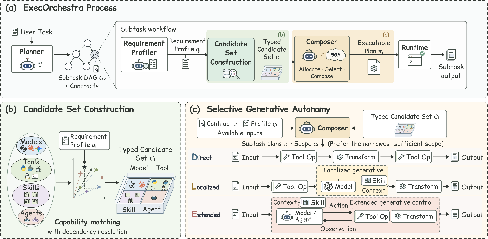

<div align="center">
  <p>
    <picture>
      <source media="(prefers-color-scheme: dark)" srcset="execorchestra/docs/assets/wordmark-dark.svg">
      
    </picture>
  </p>
  <h3>异构资源路由与编排系统</h3>
  <p>让工具、模型、技能和智能体按计划协作完成任务。</p>
  <p>
    <a href="#quick-start"></a>&nbsp;
    <a href="execorchestra/docs/SERVICES.md"></a>&nbsp;
    <a href="#documentation"></a>
  </p>
  <p><a href="README.md">English</a> · <strong>简体中文</strong></p>
</div>

<a id="overview"></a>

## ✨ 项目介绍

**ExecOrchestra** 是一个面向复杂任务的异构资源编排框架，将工具、模型、技能和智能体组合为可执行的任务流程。框架按需分配生成式处理与直接执行的职责：将明确的操作交给工具，在需要生成、判断或交互的环节引入模型与智能体。同时提供清晰的执行记录、中间产物和结果交付，便于开发者追踪任务进展、定位问题并扩展应用。

<a id="framework"></a>

## 🧩 系统框架

<p align="center">
  <a href="execorchestra/docs/assets/framework-overview.png">
    
  </a>
</p>

根据任务需求组织异构资源，并为每个子任务确定生成式参与范围。

<a id="execution-modes"></a>

### 三种执行模式

不同子任务需要模型参与的程度不同。框架支持三种执行方式：

| 执行模式 | 谁决定下一步 |
| --- | --- |
|  **直接执行（Direct）** | 计划预先确定操作及其输入，由工具依次执行。中途无需调用模型。 |
|  **局部生成（Localized）** | 模型在计划中承担明确的职责，例如生成一段处理脚本。读取、写入和计算等操作交给工具。 |
|  **交互执行（Extended）** | 模型或智能体读取工具返回的观察结果，在获准使用的工具和会话限额内决定下一步操作。 |

<a id="quick-start"></a>

## 🚀 快速开始

### 📋 环境要求

- **操作系统**：Linux x86-64
- **Python**：3.11 及以上
- **基础工具**：Git、Conda，以及已启动且当前用户可访问的 Docker Engine
- **模型服务**：兼容的大模型 API 和 可用的向量服务（默认为`Qwen3-Embedding-4B`）

### 📦 安装

1. **克隆项目仓库**

   ```bash
   git clone -b execorchestra --single-branch https://github.com/OpenBMB/ChatDev.git
   cd ChatDev
   cd execorchestra
   ```

2. **配置环境并安装依赖**

   ```bash
   conda create -n execorchestra python=3.11 -y
   conda activate execorchestra
   python -m pip install torch==2.11.0 --index-url https://download.pytorch.org/whl/cpu
   python -m pip install -r requirements.txt
   python -m scripts.prepare_release init
   test -f .env || cp .env.example .env
   ```

3. **构建 Docker 工具环境**

   ```bash
   docker build -f sgar_mvp/docker/Dockerfile.runtime -t sgar-runtime:rc1 .
   python -m sgar_mvp.scripts.seal_rc1_runtime
   ```

4. **准备向量服务环境**

   本地部署时，安装独立的向量服务环境，并下载固定版本的模型和 tokenizer。

   ```bash
   conda create -n execorchestra-embedding python=3.11 -y
   conda run -n execorchestra-embedding python -m pip install -r requirements-embedding.txt
   python -m scripts.download_embedding
   ```

   下载文件分别保存在 `.cache/embedding-model` 和 `.cache/embedding-tokenizer`。

<details>
<summary>使用已有向量服务时</summary>

跳过上面的向量服务环境和模型权重下载，仅准备匹配的 tokenizer：

```bash
python -m scripts.download_embedding --tokenizer-only
```

在 `sgar_mvp/config/embedding_release.json` 中，将 `runtime.api_endpoint_url` 改为完整的 embeddings 接口地址，将 `runtime.api_model_id` 改为服务中的模型名；`runtime.tokenizer_path` 保持为 `.cache/embedding-tokenizer`。服务需使用配置中的 Qwen3-Embedding-4B 版本，并返回归一化的 2,560 维向量。

</details>

### 🔑 配置

1. **填写 API 地址与密钥**

   编辑 `ChatDev/execorchestra/.env`，将以下值替换为自己的配置。文件内已按必填项和可选项分组添加注释。

   ```dotenv
   LLM_BASE_URL="https://your-gateway.example/v1"
   LLM_API_KEY="your-model-api-key"
   SGAR_EMBEDDING_API_KEY="your-embedding-api-key"
   ```

   - `LLM_BASE_URL` / `LLM_API_KEY`：OpenAI-compatible 模型网关地址及访问密钥。
   - `SGAR_EMBEDDING_API_KEY`：向量接口密钥；本地部署时自行设置非空的私有值，服务端和客户端读取同一份 `.env`。

2. **在框架终端加载配置**

   ```bash
   conda activate execorchestra
   set -a
   source .env
   set +a
   ```

   每次打开新的框架终端时，重新执行这一步。

### 🧰 启动服务与准备资源

1. **（可选）启动本地向量服务**

   本地部署时，在 `ChatDev/execorchestra` 中打开**第二个终端**。使用独立 GPU 服务器时，选择可用 GPU 并执行：

   ```bash
   conda activate execorchestra-embedding
   set -a
   source .env
   set +a
   export CUDA_VISIBLE_DEVICES=0
   export SGAR_EMBEDDING_DEDICATED_GPU=1
   export SGAR_EMBEDDING_MODEL_PATH="$PWD/.cache/embedding-model"
   python -m scripts.embedding_server
   ```

   默认接口为 `http://127.0.0.1:8001/v1/embeddings`。建立索引和执行任务期间保持服务运行，结束后按 `Ctrl+C` 停止。如配置已有端口则无需执行这一步。

2. **回到框架终端准备资源**

   ```bash
   python -m scripts.prepare_release all --allow-unavailable
   ```

   此命令依次检查模型、控制角色、工具和智能体，整理可用资源、建立索引并核验配置。过程会实际调用 API 和工具，可能产生费用；任一步失败即停止。不可用候选记录在 `sgar_mvp/runtime_state/preparation_report.json`。要求完整资源池全部可用时，去掉 `--allow-unavailable`。

   首次配置完成后执行一次即可，后续任务复用索引。修改配置后，如需重建索引，先备份原索引；命令不会覆盖已有索引。

<a id="your-task"></a>

### ⚡ 运行任务

准备通过后，将任务描述写入 UTF-8 文本文件，并与附件一起放入专用输入目录。替换以下占位参数即可运行：

```bash
bash scripts/run.sh \
  --query-file "<task-file>" \
  --public-input-root "<input-directory>" \
  --run-dir "<new-run-directory>"
```

| 参数 | 作用 |
| --- | --- |
| `--query-file` | 包含任务要求及预期交付内容的文本文件，需位于声明的输入目录内。 |
| `--public-input-root` | 任务获准读取的输入目录；多个独立目录可重复传入。 |
| `--run-dir` | 本次运行使用的新目录或空目录，保存日志和结果。 |
| `--input NAME=PATH` | 可选的具名附件，需位于声明的输入目录内，可重复传入。 |
| `--network-policy declared` | 网页任务配置好搜索与浏览器服务后，用此参数启用声明的联网访问；工具默认不联网。 |

终端逐步展示执行阶段、所选资源、中间产物和交付状态，同步保存在 `<new-run-directory>/progress.log`。`run_manifest.json` 记录完成状态，`delivery_manifest.json` 中的 `delivery_locator` 指向最终交付文件，路径相对于运行目录。

<details>
<summary>可选：运行示例（XBench 157）</summary>

```bash
bash scripts/run_xbench_demo.sh
```

这道 XBench DeepSearch-2510 中的题目要求查找一篇 XBench 论文的合著者。示例展示 ExecOrchestra 如何搜索网页、核对论文署名，并交付附有来源链接的答案。[示例详情](execorchestra/docs/XBENCH_DEMO.md)

</details>

<details>
<summary><strong>查看运行产物与日志说明</strong></summary>

| 运行目录中的文件 | 可以从中看到什么 |
| --- | --- |
| `progress.log` | 与终端对应的阶段记录、步骤交接和中间产物预览。 |
| `pipeline.log` | 详细请求、候选评分、计划校验和运行诊断。设置 `SGAR_CONSOLE=verbose` 也可在终端展开详细诊断。 |
| `run_manifest.json` | 整次运行的最终状态及已记录的失败原因。 |
| `delivery_manifest.json`（有交付时） | 最终产物的位置和用于核对内容的哈希。 |
| `experiment_report.md` | 本次运行的报告。基准测试另有独立的答案评分环节。 |

</details>

<a id="documentation"></a>

## 📚 项目文档

| 从这里开始 | 可以找到什么 |
| --- | --- |
| [安装与运行](execorchestra/docs/QUICKSTART.md) | 最小示例验收、准备阶段说明及排错。 |
| [环境与服务](execorchestra/docs/SETUP.md) · [模型配置](execorchestra/docs/SERVICES.md) | 本地配置、模型网关、向量服务和工具依赖。 |
| [基准评测](execorchestra/docs/BENCHMARKS.md) | GAIA、Terminal-Bench 的运行入口和评分流程。 |
| [资源目录](execorchestra/Pool/resources/) · [框架源码](execorchestra/sgar_mvp/src/) | 资源声明、编排实现和执行逻辑。 |
| [第三方声明](execorchestra/THIRD_PARTY.md)| 本项目内涉及到所有其他来源的内容。 |

## 👥 贡献者

<table>
  <tr>
    <td align="center" width="112"><a href="https://github.com/TL-Z"></a><br><sub><a href="https://github.com/TL-Z">TL-Z</a></sub></td>
    <td align="center" width="112"><a href="https://github.com/WilsonWukz"></a><br><sub><a href="https://github.com/WilsonWukz">WilsonWukz</a></sub></td>
    <td align="center" width="112"><a href="https://github.com/ffcosmos"></a><br><sub><a href="https://github.com/ffcosmos">ffcosmos</a></sub></td>
    <td align="center" width="112"><a href="https://github.com/Wuuu-uu"></a><br><sub><a href="https://github.com/Wuuu-uu">Wuuu-uu</a></sub></td>
    <td align="center" width="112"><a href="https://github.com/hendrick-wang"></a><br><sub><a href="https://github.com/hendrick-wang">hendrick-wang</a></sub></td>
    <td align="center" width="112"><a href="https://github.com/huatl98"></a><br><sub><a href="https://github.com/huatl98">huatl98</a></sub></td>
    <td align="center" width="112"><a href="https://github.com/inwt2333"></a><br><sub><a href="https://github.com/inwt2333">inwt2333</a></sub></td>
  </tr>
  <tr>
    <td align="center" width="112"><a href="https://github.com/LLLLLLsk0231"></a><br><sub><a href="https://github.com/LLLLLLsk0231">LLLLLLsk0231</a></sub></td>
    <td align="center" width="112"><a href="https://github.com/cuixitong"></a><br><sub><a href="https://github.com/cuixitong">cuixitong</a></sub></td>
    <td align="center" width="112"><a href="https://github.com/qianc62"></a><br><sub><a href="https://github.com/qianc62">qianc62</a></sub></td>
  </tr>
</table>

## 🤝 致谢

<a href="https://www.shlab.org.cn/">
  <picture>
    <source media="(prefers-color-scheme: dark)" srcset="execorchestra/docs/assets/shanghai-ai-laboratory.webp">
    
  </picture>
</a>
