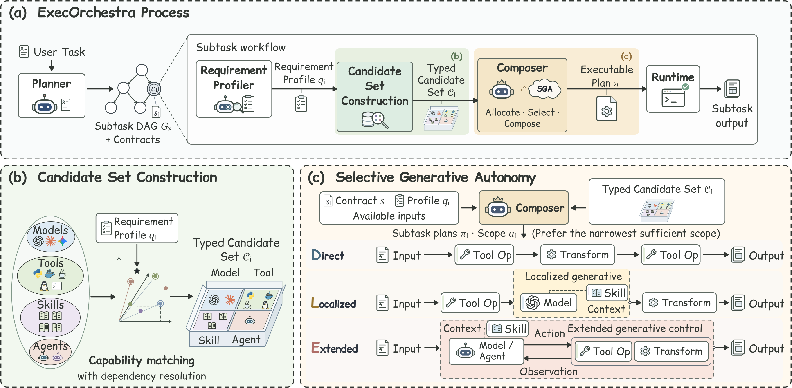

<div align="center">
  <p>
    <picture>
      <source media="(prefers-color-scheme: dark)" srcset="execorchestra/docs/assets/wordmark-dark.svg">
      
    </picture>
  </p>
  <h3>Heterogeneous Resource Routing and Orchestration</h3>
  <p>Coordinate tools, models, skills, and agents through executable plans.</p>
  <p>
    <a href="#quick-start"></a>&nbsp;
    <a href="#documentation"></a>&nbsp;
    <a href="https://huggingface.co/datasets/Some-thy/CoEvoke"></a>
  </p>
  <p><strong>English</strong> · <a href="README-zh.md">简体中文</a></p>
</div>

<a id="overview"></a>

## ✨ Overview

**ExecOrchestra** is a heterogeneous resource orchestration framework for complex tasks. It combines tools, models, skills, and agents into executable workflows, allocating generative processing and direct execution as needed. Tools handle explicitly specified operations, while models and agents contribute where generation, judgment, or interaction is required. Clear execution records, intermediate artifacts, and delivered results help developers follow progress, diagnose issues, and extend their applications.

<a id="framework"></a>

## 🧩 System framework

<p align="center">
  <a href="execorchestra/docs/assets/framework-overview.png">
    
  </a>
</p>

Organize heterogeneous resources around task requirements and determine the generative scope of each subtask.
<a id="execution-modes"></a>

### Three execution modes

A plan gives the model as much control as the subtask calls for:

| Execution mode | How the work gets done |
| --- | --- |
|  **Direct** | The plan fixes the operations and their inputs. Tools carry them out without an intermediate model call. |
|  **Localized** | The plan gives a model a specific job, such as writing a short processing script. Tools do the reading, writing, or computation. |
|  **Extended** | A model or agent can inspect a tool’s response and choose its next action within the permitted tools and session limits. |

<a id="quick-start"></a>

## 🚀 Quick start

### 📋 Prerequisites

- **Operating system**: Linux x86-64
- **Python**: 3.11 or higher
- **Tools**: Git, Conda, and a running Docker Engine accessible to your user
- **Model services**: A compatible LLM API and Embedding model services (`Qwen3-Embedding-4B` by default).

### 📦 Installation

1. **Clone the repository**

   ```bash
   git clone -b execorchestra --single-branch https://github.com/OpenBMB/ChatDev.git
   cd ChatDev
   cd execorchestra
   ```
2. **Set the environment and install dependencies**

   ```bash
   conda create -n execorchestra python=3.11 -y
   conda activate execorchestra
   python -m pip install torch==2.11.0 --index-url https://download.pytorch.org/whl/cpu
   python -m pip install -r requirements.txt
   python -m scripts.prepare_release init
   test -f .env || cp .env.example .env
   ```

3. **Build the Docker tool environment**

   ```bash
   docker build -f sgar_mvp/docker/Dockerfile.runtime -t sgar-runtime:rc1 .
   python -m sgar_mvp.scripts.seal_rc1_runtime
   ```

4. **Prepare the embedding model service**

   For local deployment, install the embedding environment and download the pinned model and tokenizer.

   ```bash
   conda create -n execorchestra-embedding python=3.11 -y
   conda run -n execorchestra-embedding python -m pip install -r requirements-embedding.txt
   python -m scripts.download_embedding
   ```

   Downloads are stored under `.cache/embedding-model` and `.cache/embedding-tokenizer`.

<details>
<summary>Using an existing embedding service instead</summary>

Skip the embedding environment and model-weight download above. Download only the matching tokenizer:

```bash
python -m scripts.download_embedding --tokenizer-only
```

In `sgar_mvp/config/embedding_release.json`, set `runtime.api_endpoint_url` to the full embeddings URL and `runtime.api_model_id` to its served model name. Keep `runtime.tokenizer_path` as `.cache/embedding-tokenizer`. The endpoint must use the configured Qwen3-Embedding-4B revision and return normalized 2,560-dimensional vectors.

</details>

### 🔑 Configuration

1. **Fill in API endpoints and keys**

   Edit `ChatDev/execorchestra/.env`. Replace the values below with your own; the file contains grouped comments for required and optional settings.

   ```dotenv
   LLM_BASE_URL="https://your-gateway.example/v1"
   LLM_API_KEY="your-model-api-key"
   SGAR_EMBEDDING_API_KEY="your-embedding-api-key"
   ```

   - `LLM_BASE_URL` / `LLM_API_KEY`: Your OpenAI-compatible model gateway and its access key.
   - `SGAR_EMBEDDING_API_KEY`: The embedding endpoint key. For local deployment, choose a private nonempty value; the service and client load the same `.env`.

2. **Load configuration into the framework terminal**

   ```bash
   conda activate execorchestra
   set -a
   source .env
   set +a
   ```

   Repeat this step when opening a new framework terminal.

### 🧰 Runtime preparation

1. **(Optional) Start the local embedding service** 

   For local deployment, open a **second terminal** in `ChatDev/execorchestra`. On a dedicated GPU server, choose an available GPU and run:

   ```bash
   conda activate execorchestra-embedding
   set -a
   source .env
   set +a
   export CUDA_VISIBLE_DEVICES=0
   export SGAR_EMBEDDING_DEDICATED_GPU=1
   export SGAR_EMBEDDING_MODEL_PATH="$PWD/.cache/embedding-model"
   python -m scripts.embedding_server
   ```

   The default endpoint is `http://127.0.0.1:8001/v1/embeddings`. Keep it running during preparation and task execution; stop it with `Ctrl+C` afterward.

2. **Prepare resources in the framework terminal**

   ```bash
   python -m scripts.prepare_release all --allow-unavailable
   ```

   This command checks models, control roles, tools, and agents, prepares the usable resource pool, builds its index, and verifies configuration in that order. It makes live API/tool requests and may incur charges; it stops at the first failed stage. Unavailable candidates are recorded in `sgar_mvp/runtime_state/preparation_report.json`. Omit `--allow-unavailable` when every configured candidate must be available.

<a id="your-task"></a>

### ⚡ Run a task

After preparation succeeds, write your request to a UTF-8 text file and place it with any attachments in a dedicated input directory. Replace the placeholders:

```bash
bash scripts/run.sh \
  --query-file "<task-file>" \
  --public-input-root "<input-directory>" \
  --run-dir "<new-run-directory>"
```

| Parameter | Meaning |
| --- | --- |
| `--query-file` | File containing the task request and expected deliverable; it must be inside the declared input directory. |
| `--public-input-root` | Directory the task may read. Repeat this option for multiple separate input roots. |
| `--run-dir` | New or empty directory for this attempt’s logs and results. |
| `--input NAME=PATH` | Optional named attachment inside a declared input root. May be repeated. |
| `--network-policy declared` | Enable declared network access for web tasks after configuring search/browser services. Tool network access is disabled by default. |

The terminal displays each stage, selected resources, intermediate outputs, and delivery status. The same readable trace is saved to `<new-run-directory>/progress.log`. Check `run_manifest.json` for completion status and `delivery_manifest.json` for the delivered file path (`delivery_locator`, relative to the run directory).

<details>
<summary>Optional: run an example (XBench case 157)</summary>

```bash
bash scripts/run_xbench_demo.sh
```

This XBench DeepSearch-2510 task asks for the name of a coauthor of an XBench paper. The example shows how ExecOrchestra searches the web, checks the paper's author list, and delivers an answer with source links. [Example details](execorchestra/docs/XBENCH_DEMO.md)

</details>

<details>
<summary><strong>View output files and log details</strong></summary>

| In the run directory | Use it to |
| --- | --- |
| `progress.log` | Follow the same guided stages seen in the terminal, including intermediate output previews. |
| `pipeline.log` | Inspect detailed requests, candidate scores, plan validation and runtime diagnostics. Use `SGAR_CONSOLE=verbose` to also show detailed diagnostic records live. |
| `run_manifest.json` | Check the final run status and the recorded cause of a failure. |
| `delivery_manifest.json`, when present | Locate the delivered output and verify its content hash. |
| `experiment_report.md` | Read the run report. Benchmark answer grading is a separate step. |

</details>

## 🤗 Related Dataset

**CoEvoke** (https://huggingface.co/datasets/Some-thy/CoEvoke) captures multi-agent collaboration across software engineering, mathematical reasoning, natural-language logical reasoning, and logic-grid puzzles. Each episode records agent messages, tool interactions, and intermediate review decisions, providing trajectory examples for analyzing coordination and training agents to work together.

| Source | Parent trajectories | Canonical tasks | Single-loop | Adjacent double-loop | Total episodes |
| --- | ---: | ---: | ---: | ---: | ---: |
| SWE (`swe_oracle`) | 1,763 | 1,763 | 3,315 | 1,552 | 4,867 |
| DeepMath (`deepmath`) | 923 | 831 | 1,656 | 733 | 2,389 |
| ProofWriter (`proofwriter`) | 1,392 | 1,096 | 2,315 | 923 | 3,238 |
| ZebraLogic (`zebra`) | 489 | 440 | 905 | 416 | 1,321 |
| **Total** | **4,567** | **4,130** | **8,191** | **3,624** | **11,815** |

<a id="documentation"></a>

## 📚 Documentation

| Start here | What you will find |
| --- | --- |
| [Install & run](execorchestra/docs/QUICKSTART.md) | Detailed example verification and preparation troubleshooting. |
| [Environment & services](execorchestra/docs/SETUP.md) · [Model configuration](execorchestra/docs/SERVICES.md) | Local settings, model gateways, embeddings and tool dependencies. |
| [Benchmark evaluation](execorchestra/docs/BENCHMARKS.md) | GAIA and Terminal-Bench entry points and scoring. |
| [Resource catalog](execorchestra/Pool/resources/) · [Framework source](execorchestra/sgar_mvp/src/) | Resource declarations, orchestration and execution logic. |
| [Third-party notices](execorchestra/THIRD_PARTY.md)| All involved content from other sources in this project. |

## 👥 Contributors

<table>
  <tr>
    <td align="center" width="112"><a href="https://github.com/TL-Z"></a><br><sub><a href="https://github.com/TL-Z">TL-Z</a></sub></td>
    <td align="center" width="112"><a href="https://github.com/WilsonWukz"></a><br><sub><a href="https://github.com/WilsonWukz">WilsonWukz</a></sub></td>
    <td align="center" width="112"><a href="https://github.com/ffcosmos"></a><br><sub><a href="https://github.com/ffcosmos">ffcosmos</a></sub></td>
    <td align="center" width="112"><a href="https://github.com/Wuuu-uu"></a><br><sub><a href="https://github.com/Wuuu-uu">Wuuu-uu</a></sub></td>
    <td align="center" width="112"><a href="https://github.com/hendrick-wang"></a><br><sub><a href="https://github.com/hendrick-wang">hendrick-wang</a></sub></td>
    <td align="center" width="112"><a href="https://github.com/huatl98"></a><br><sub><a href="https://github.com/huatl98">huatl98</a></sub></td>
    <td align="center" width="112"><a href="https://github.com/inwt2333"></a><br><sub><a href="https://github.com/inwt2333">inwt2333</a></sub></td>
  </tr>
  <tr>
    <td align="center" width="112"><a href="https://github.com/LLLLLLsk0231"></a><br><sub><a href="https://github.com/LLLLLLsk0231">LLLLLLsk0231</a></sub></td>
    <td align="center" width="112"><a href="https://github.com/cuixitong"></a><br><sub><a href="https://github.com/cuixitong">cuixitong</a></sub></td>
    <td align="center" width="112"><a href="https://github.com/qianc62"></a><br><sub><a href="https://github.com/qianc62">qianc62</a></sub></td>
  </tr>
</table>

## 🤝 Acknowledgments

<a href="https://www.shlab.org.cn/">
  <picture>
    <source media="(prefers-color-scheme: dark)" srcset="execorchestra/docs/assets/shanghai-ai-laboratory.webp">
    
  </picture>
</a>
